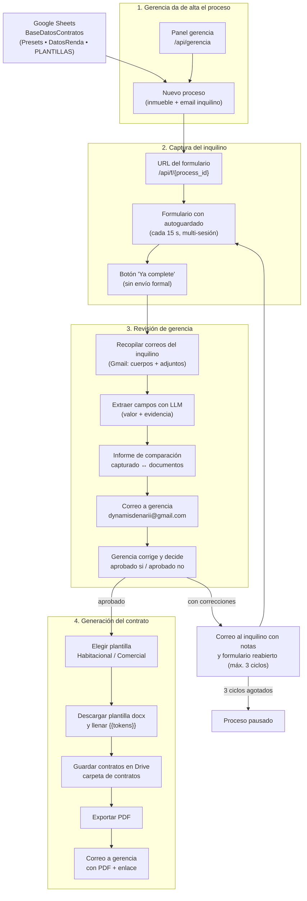

# Diagrama del flujo de contratos de arrendamiento

## Campos calculados

Se calculan en `calcula_derivados` (`apps/worker/src/worker/workflows/arrendamiento_utilidades.py`)
a partir de los datos capturados y de `DatosRenda`, justo antes de llenar la plantilla:

| Campo calculado | Fórmula / fuente |
| --- | --- |
| `Texto renta mensual bruta` | `Renta mensual bruta` → número a letras en pesos con centavos `XX/100 M.N.` |
| `Valor del periodo` | `Renta mensual bruta × 12` |
| `Total con dcto pp` | `Renta mensual bruta − Descuento PP` (solo si hay renta) |
| `Texto total con dcto pp` | el total anterior a letras |
| `Importe DEG` / `Texto DEG` | depósito en garantía → formato y letras |
| `Fecha Firma` | `Fecha Firma` (varios formatos) → `15 de marzo de 2025` |
| `Día de pago mensual` / `Texto día de pago mensual` | día de `Fecha Firma` → `1` / `UNO` en letras |
| `Año firma texto` | año de `Fecha Firma` → `DOS MIL VEINTICINCO` |

La mezcla final es `valores = arrendador (DatosRenda) + formulario del inquilino + derivados`;
los `{{tokens}}` de la plantilla sin valor se reportan en el informe como **pendientes**.
Para agregar un campo calculado nuevo basta añadirlo en `calcula_derivados` con su prueba.
